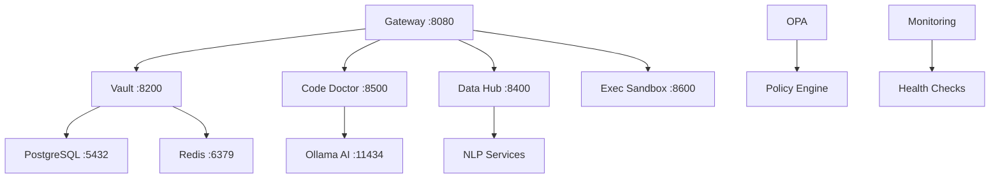

# 🇪🇺 EU-UNION-AI-PACT VS Code Pipelines

> **Complete DevSecOps/AI Pipeline with Local NLP/IP Stack**  
> 100% Free & Open Source | Production-Ready | Privacy-First

[](https://opensource.org/licenses/MIT)
[](https://docker.com)
[](https://vaultproject.io)
[](https://ollama.ai)

## 🚀 Quick Start

```bash
# Clone repository
git clone https://github.com/YOUR_USERNAME/EU-UNION-AI-PACT-VS-Code-Pipelines.git
cd EU-UNION-AI-PACT-VS-Code-Pipelines

# Start all services
./scripts/start-all.sh

# Check health
./scripts/health-check.sh

# Access services
open http://localhost:8080  # Gateway
open http://localhost:8200  # Vault (Token: root-dev-token)
```

## ✨ Features

### 🛡️ DevSecOps Pipeline

- **HashiCorp Vault** - Secret management & encryption
- **OPA Policies** - Policy-based access control  
- **Audit Logging** - Complete provenance tracking
- **Auto-Healing** - Code Doctor with AI repair

### 🧠 AI/ML Stack

- **Local LLMs** - Ollama integration (LLaMA 3.2)
- **Vector Embeddings** - Sentence Transformers
- **PostgreSQL** - pgvector for semantic search
- **RAG Pipeline** - Document processing & retrieval

### 🌐 Invisible Hosting

- **Cloudflare Tunnel** - Public HTTPS without domain
- **nip.io** - IP-based domains  
- **Dynamic Registry** - TrailStar-like functionality
- **SSL/TLS** - Automatic certificate management

### 🔒 Security & Compliance

- **Zero Trust** - All services secured by default
- **GDPR Ready** - Privacy-first architecture
- **IP Protection** - Intellectual property ledger
- **Secure Sandbox** - Code execution isolation

## 🏗️ Architecture



## 📦 Services

| Service | Port | Description | Status |
|---------|------|-------------|--------|
| **Gateway** | 8080 | Web Interface & API Gateway | ✅ |
| **Vault** | 8200 | Secret Management | ✅ |
| **Code Doctor** | 8500 | Code Healing & Normalization | ✅ |
| **Data Hub** | 8400 | RAG + Open Data + API Search | ✅ |
| **Exec Sandbox** | 8600 | Secure Code Execution | ✅ |
| **PostgreSQL** | 5432 | Database with pgvector | ✅ |
| **Redis** | 6379 | Caching Layer | ✅ |
| **Ollama** | 11434 | Local AI Models | ✅ |

## 🛠️ Installation

### Prerequisites

- Docker & Docker Compose
- Python 3.11+
- Git

### Setup Options

#### Option 1: Simple Setup (Recommended)

```bash
./scripts/simple-setup.sh
```

#### Option 2: Full Setup with AI

```bash
./scripts/arch-setup.sh  # For Arch Linux
./scripts/free-master-setup.sh  # Universal
```

#### Option 3: Invisible Hosting

```bash
# Cloudflare Tunnel
./scripts/setup-cloudflare-tunnel.sh

# nip.io (IP-based domains)
./scripts/setup-nip-io.sh
```

## 🔧 Management

### Start/Stop Services

```bash
# Start all
./scripts/start-all.sh

# Stop all  
./scripts/stop-all.sh

# Health check
./scripts/health-check.sh
```

### Docker Management

```bash
# Full stack
docker-compose -f docker-compose.vault.yml up -d

# Simple stack
docker-compose -f docker-compose.simple.yml up -d

# View logs
docker-compose logs -f
```

### AI Models

```bash
# Pull models
ollama pull llama3.2:1b
ollama pull nomic-embed-text

# Chat with AI
ollama run llama3.2:1b
```

## 📁 Project Structure

```text
EU-UNION-AI-PACT-VS-Code-Pipelines/
├── 🔐 vault/                    # HashiCorp Vault config
├── 🧠 nlp/                      # NLP & AI services  
├── 🛠️ services/                 # Microservices
│   ├── code_doctor/             # Code healing & normalization
│   ├── data_hub/                # RAG + Open Data + APIs
│   └── exec_sandbox/            # Secure code execution
├── 📜 scripts/                  # Management scripts
├── 🐳 docker-compose.*.yml      # Container orchestration
├── 🐍 venv/                     # Python virtual environment
└── 📋 docs/                     # Documentation
```

## 🌟 Use Cases

### For Developers

- **Code Quality** - Automatic healing & normalization
- **Local AI** - No external API dependencies  
- **Security** - Vault-integrated development
- **Testing** - Secure sandbox execution

### For Organizations

- **Compliance** - GDPR & privacy-first
- **Cost Savings** - 100% free, no licensing
- **Security** - Zero-trust architecture
- **Scalability** - Container-native design

### For Research

- **Data Processing** - RAG pipeline for documents
- **Open Data** - EU & government data integration
- **ML Experiments** - Local model deployment
- **Provenance** - Complete audit trails

## 💰 Cost Breakdown

| Component | Cost | Alternative |
|-----------|------|-------------|
| **Hosting** | $0 | vs. $100+/month |
| **AI APIs** | $0 | vs. $500+/month |
| **Security** | $0 | vs. $200+/month |
| **Monitoring** | $0 | vs. $50+/month |
| **Total** | **$0** | **vs. $850+/month** |

## 🔐 Security

- **Encryption at Rest** - Vault transit engine
- **Encryption in Transit** - TLS everywhere
- **Zero Trust** - No implicit permissions
- **Audit Logging** - Complete activity tracking
- **Policy Engine** - OPA-based access control
- **Secure Defaults** - Production-ready configuration

## 📊 Monitoring

- **Health Checks** - Automated service monitoring
- **Metrics** - Prometheus integration ready
- **Logging** - Centralized log collection
- **Alerting** - Ready for Grafana integration

## 🤝 Contributing

1. Fork the repository
2. Create feature branch (`git checkout -b feature/amazing-feature`)
3. Commit changes (`git commit -m 'Add amazing feature'`)
4. Push to branch (`git push origin feature/amazing-feature`)
5. Open Pull Request

## 📄 License

This project is licensed under the MIT License - see the [LICENSE](LICENSE) file for details.

## 🙏 Acknowledgments

- **HashiCorp** - Vault security platform
- **Open Policy Agent** - Policy engine
- **PostgreSQL** - Database with pgvector
- **Ollama** - Local AI model deployment
- **EU Open Data** - Data sources & APIs

---

## 🚀 Get Started Now

```bash
git clone https://github.com/YOUR_USERNAME/EU-UNION-AI-PACT-VS-Code-Pipelines.git
cd EU-UNION-AI-PACT-VS-Code-Pipelines
./scripts/simple-setup.sh
```

**Ready in 5 minutes!** 🎉

---

*Made with ❤️ for the European Union AI Pact*
